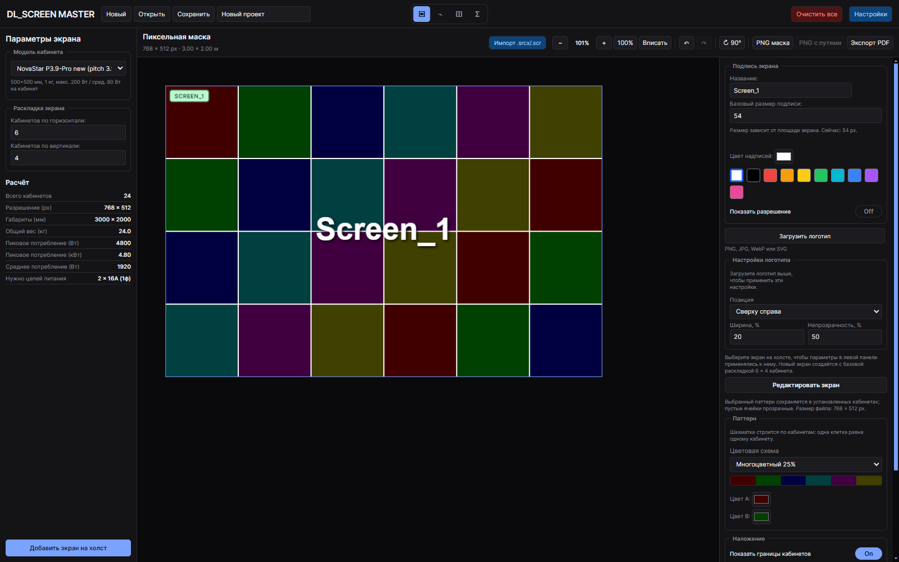
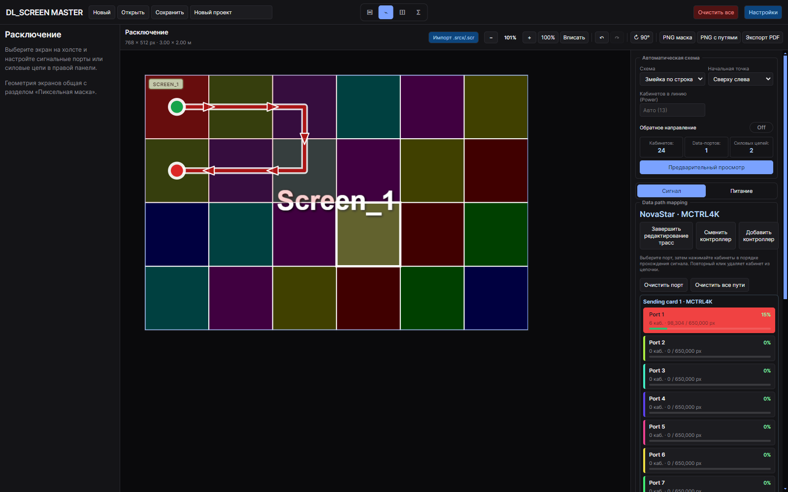
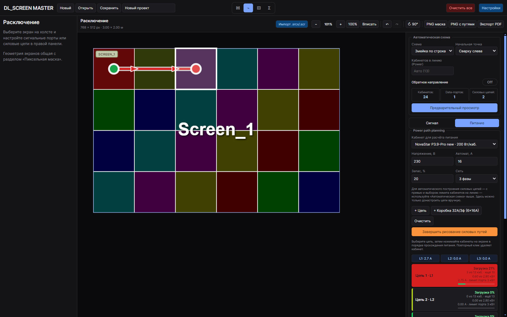
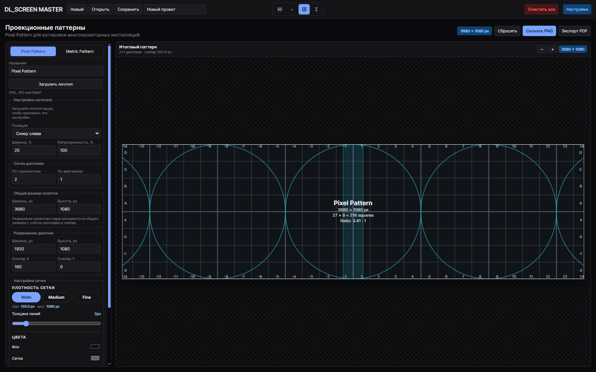
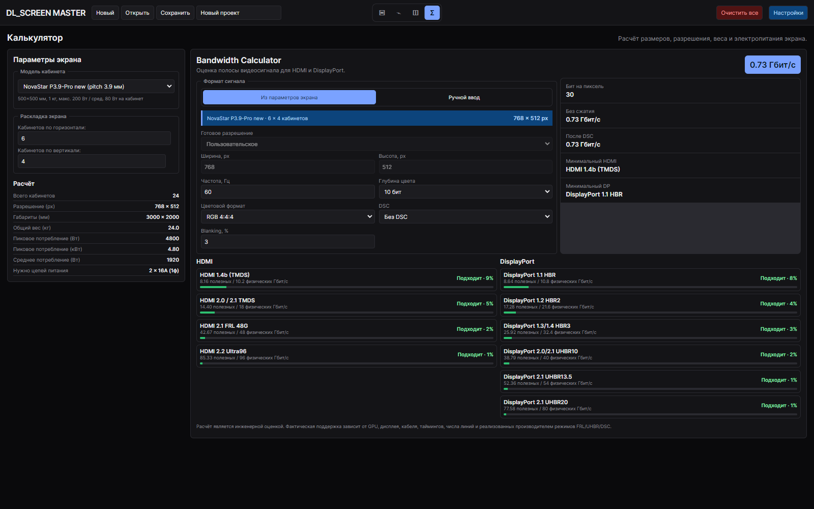
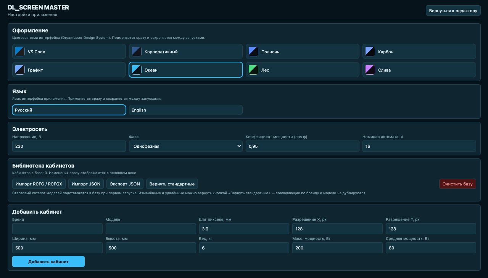

# DL_SCREEN MASTER

[Русский](README.md) · **English**

A desktop app (Electron + React + TypeScript) for designing LED video
walls: cabinet layouts, pixel masks, signal and power wiring diagrams,
projection patterns for multi-projector installations, and engineering
calculators.



## Features

- **Pixel mask** — lay out a screen from cabinets at native resolution,
  test patterns (checkerboard, stripes, gradient, grid, solid fill),
  multiple screens on one workspace with drag-and-drop, edge snapping,
  rotation and alignment. Screen label, logo overlay, color pickers and
  cabinet grid/border display.
- **Wiring** — manual and automatic signal (data path) and power (power
  path) routing:
  - auto-router with snake/row/column/center patterns, a selectable
    starting corner, and a graphical preview before applying;
  - port-capacity checks (pixels/cabinets per port) and power-circuit
    overload checks, balanced across phases L1/L2/L3;
  - add a NovaStar controller (MCTRL4K/660/660 Pro, H9, H15), switch
    controllers, or **add an additional controller** when the current
    one runs out of ports — already-assigned traces are preserved;
  - one click to add a **3-phase 32A → 6×16A distro box**, split across
    phases automatically.
- **NovaStar import** — `.srcx`/`.scr` (a whole scene, auto-matched
  against the cabinet library) and `.rcfg`/`.rcfgx` (a single cabinet).
- **Projection patterns** — a Pixel Pattern generator (grid, circles,
  overlap) and a Metric Pattern mode for aligning multi-projector
  installations, with a display grid, overlap settings, and PNG/PDF
  export.
- **Calculator** — weight, dimensions, power draw and recommended
  number of power circuits for a screen; a Bandwidth Calculator for
  HDMI 1.4b–2.2 and DisplayPort 1.1–2.1 (RGB/YCbCr, color depth,
  blanking, DSC).
- **Export** — PNG mask (combined and per-screen for multiple selected
  screens), PNG with the signal-path overlay, a project PDF report with
  a summary table, masks and wiring diagrams.
- **`.dlscreen` projects** — save/open through Electron IPC; the custom
  cabinet library is stored separately from the project file.
- **Color themes** — 8 DreamLaser Design System themes, applied
  instantly and remembered between launches.
- **Two interface languages** — Russian and English, switchable in
  settings, applied instantly and remembered between launches.
- **Starter cabinet library** — models from a local catalog are added on
  first launch, so a screen can be assembled right away; deleted or edited
  ones come back with “Restore built-in” in settings (no duplicates by brand
  and model).

## Cabinet catalog

The starter model catalog is not code but a separate file,
`catalog/cabinet-presets.json`. It is **not stored in the repository** (the
`catalog/*.json` pattern in `.gitignore`), so the model data stays local and
is not pushed to GitHub. The format and lookup order are described in
[catalog/README.md](catalog/README.md).

- The app looks for the catalog at `$DL_CABINET_CATALOG`, then at
  `<app root>/catalog/cabinet-presets.json`.
- Without the file the app still works: the library is simply empty, cabinets
  are added manually or by importing RCFG/`.srcx`, and “Restore built-in”
  reports that no catalog was found.
- The catalog stays local: it is not part of `build.files`, so installers (and
  GitHub Actions releases) ship with an empty cabinet library. It is only
  seeded when running from source — handy for keeping a working set of models
  to yourself without publishing it.

## Screenshots

| Signal paths & controllers | Power circuits |
|---|---|
|  |  |

| Projection patterns | Calculator |
|---|---|
|  |  |

<details>
<summary>Settings & color themes</summary>



</details>

## Install & run

```bash
npm install
npm run dev      # start in development mode
```

```bash
npm run build     # production build of renderer/main
npm run package   # build an installer (electron-builder)
```

## Documentation

A full user guide lives at [docs/USAGE.en.md](docs/USAGE.en.md)
([русская версия](docs/USAGE.md)): the cabinet library, working with
masks, NovaStar import, building signal and power diagrams, projection
patterns, the calculator and export.

## Project structure

```
src/
  main/            — Electron main process (window, IPC, file dialogs)
  renderer/        — React UI
    components/    — mask editor, wiring, calculators
    sections/      — projection patterns
    i18n/          — interface translations (ru/en) and the language context
  shared/          — shared code: data types and calculation logic
                     (depends on neither Electron nor React)
catalog/
  README.md         — starter catalog format (the JSON itself is not committed)
docs/
  screenshots/      — images for the README
  USAGE.md          — user guide (Russian)
  USAGE.en.md       — user guide (English)
```
