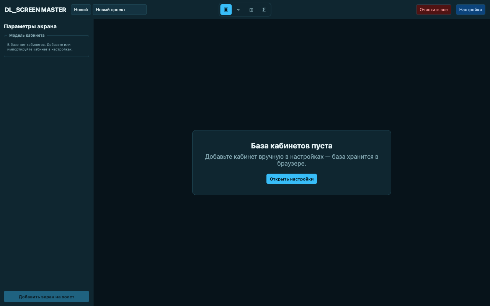

# Web-версия для CRM

Ветка `crm` — сборка приложения **без Electron**: тот же React-интерфейс,
который встраивается в CRM как обычная статика (iframe или отдельный виджет).
Релизов из этой ветки нет: только код и CI-проверки.



## Сборка

```bash
npm install
npm run build:web     # → dist-web/
npm run preview:web   # локальный предпросмотр на http://127.0.0.1:4173
```

`dist-web/index.html` и ассеты используют относительные пути (`base: './'`),
поэтому сборку можно положить в любую подпапку CRM-хоста.

## Встраивание

```html
<iframe
  src="/led-designer/index.html"
  title="DL_SCREEN MASTER"
  style="width: 100%; height: 900px; border: 0"
  allow="clipboard-write"
></iframe>
```

Абсолютные адреса не нужны; для домена CRM достаточно отдать статику из
подпапки. Приложение не обращается к сети, кроме опциональной загрузки
каталога кабинетов (см. ниже).

## Что работает

- Пиксельная маска и расключение (сигнальные и силовые цепи), Undo/Redo.
- Калькулятор мощности, Bandwidth Calculator, проекционные паттерны.
- Темы оформления и переключение языка — сохраняются в `localStorage`.
- База кабинетов — в `localStorage` (ключ `dl-screen-master-cabinet-presets`):
  добавление, редактирование, удаление, «Вернуть стандартные».
- Экспорт PNG-масок, CSV-ведомости и Resolume XML — обычное скачивание
  файла браузером.

## Чего нет в web-версии

| Операция | Почему |
|---|---|
| Открыть/сохранить проект в `.dlscreen` | нет доступа к файловой системе (кнопки скрыты) |
| Импорт `.srcx/.scr` и RCFG/RCFGX | файловые диалоги Electron (кнопки скрыты) |
| Импорт/экспорт JSON библиотеки | то же |
| PDF-отчёт | рендерится в main-процессе Electron |

Проект в web-версии живёт только в памяти вкладки: при перезагрузке страницы
экраны не восстанавливаются, база кабинетов — сохраняется.

## Каталог кабинетов

Каталог — локальные данные, в git его нет. Положите `catalog/cabinet-presets.json`
в репозиторий **до сборки**: `npm run build:web` скопирует его в
`dist-web/catalog/`. Если сборка уже готова, файл можно положить рядом с
`index.html` вручную — web-версия читает его по относительному пути
`catalog/cabinet-presets.json`.

При первом запуске в браузере (когда база ещё не создана) стартовый каталог
подставляется автоматически и сохраняется в `localStorage`. Если базу очистили
кнопкой «Очистить все», сама она не вернётся — в настройках есть «Вернуть
стандартные». Формат описан в [`catalog/README.md`](../catalog/README.md).
Если файла нет, «Вернуть стандартные» сообщает, что каталог не найден.

## Связка с узлом LED-стены (DL Design)

Из схемы CRM маски открываются ссылкой:

```
/masks/?wall=<id стены>&doc=<id схемы>&preset=<id кабинета>&model=<модель>&cols=<N>&rows=<M>&name=<имя стены>
```

- `preset` — id модели в `catalog/cabinet-presets.json`; `model` — запасной признак.
- `wall` — id узла: по нему маска **привязывается к ноде**. Первое открытие
  создаёт экран и сразу выбирает его; повторное открытие поднимает тот же экран
  из `localStorage` (ключ `dl-screen-master-masks-screen:<wall>`) вместе с
  правками — сеткой, вырезами, подписью, паттерном.
- Геометрию (кабинет, `cols`/`rows`) задаёт схема: при изменении в дизайне и
  повторном открытии экран маски получает новую сетку, вырезы вне неё
  отбрасываются. Правки оформления при этом сохраняются.
- Это привязка **в браузере**: у другого пользователя/устройства своя копия.
  Общая маска для всех требует серверного хранения (следующий шаг).

Сервер дизайна берёт список кабинетов из этого же каталога: `MASKS_CATALOG`
или `MASKS_DIST/catalog/cabinet-presets.json`. Без каталога дизайн откатывается
на заметки `dl/LED_Screens`.

### Сводка по силовым путям (для панели LED-стены)

Как только в масках разведены силовые пути, приложение публикует по id стены
сводку в `localStorage` — ключ `dl-screen-master-masks-power:<wall>`:

```json
{ "version": 1, "summary": {
  "phases": 3, "voltage": 230, "breakerAmps": 16, "safetyMarginPercent": 20, "powerFactor": 0.95,
  "cabinets": 32, "assigned": 32, "maxPowerW": 8000, "avgPowerW": 3200,
  "loads": [{ "phase": "L1", "cabinets": 16, "maxPowerW": 4000, "avgPowerW": 1600, "amps": 18.3 }],
  "imbalancePercent": 150, "controller": { "model": "H9", "ports": 16 },
  "signal": [{ "controller": "H9", "card": 1, "port": 7, "cabinets": 12 }],
  "boxes": [{ "name": "Коробка 1", "sockets": [{ "circuit": "Цепь 1", "phase": "L1", "cabinets": 16 }] }],
  "updatedAt": "2026-11-17T14:19:29Z" } }
```

Дизайн читает её в панели LED-стены: показывает фактические кВт и ток по фазам,
сколько кабинетов разведено, и предупреждает, если фаза не используется или
перекос больше 10 % (`readMasksPower`/`masksPowerUneven` в
`design-app/src/masks.js`). Поле `controller` — контроллер, выбранный в масках
для этого экрана; по нему дизайн предлагает связать стену с контроллером на
схеме (ассоциация `wall.controller_id`, пунктирная линия на канвасе).
`signal` и `boxes` — линии расключения: занятые порты контроллера (карта, номер порта —
в дизайне это «LAN OUT N») и занятые розетки силовых коробок. По ним у стены появляется
по коннектору на контроллер и на коробку, а от конкретных портов устройства идут
пунктирные линии; коробка на схеме ассоциируется через `wall.box_links` (имя коробки →
распределитель). Без сводки дизайн показывает только своё
«ровное» распределение с пометкой «расчёт».

## Ограничения

- Данные хранятся в браузере конкретного пользователя: между менеджерами и
  устройствами база не синхронизируется. Для общей базы нужен серверный
  слой CRM (следующий шаг, вне этой ветки).
- `localStorage` может быть недоступен, если CRM открывает iframe с жёсткой
  политикой — тогда приложение работает в памяти без сохранения.
- Диалоги подтверждения используют `window.confirm`; в песочнице iframe
  (`sandbox` без `allow-modals`) они блокируются — не включайте такой режим.
